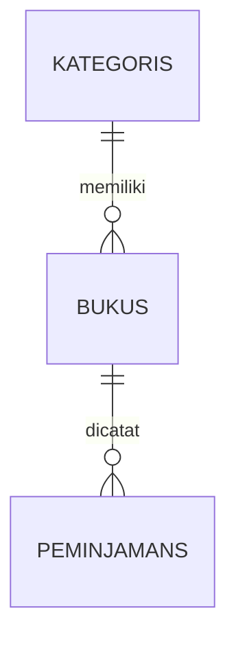
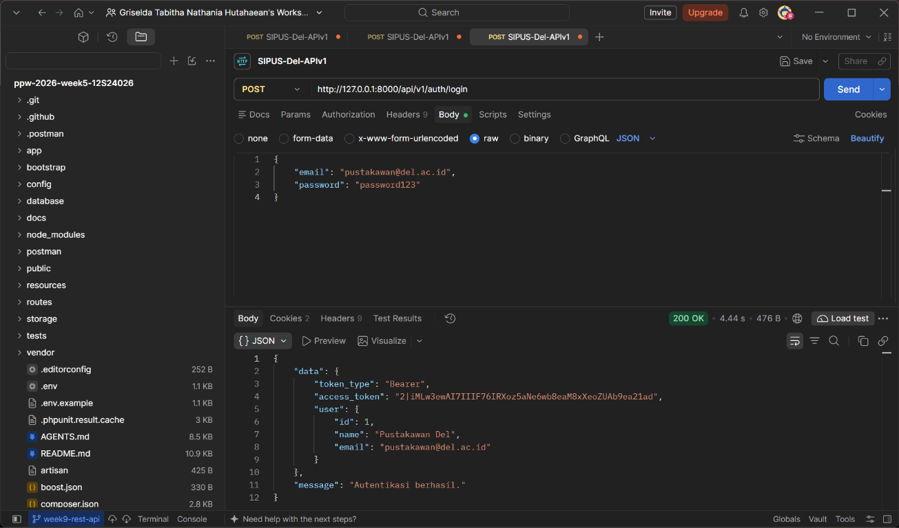
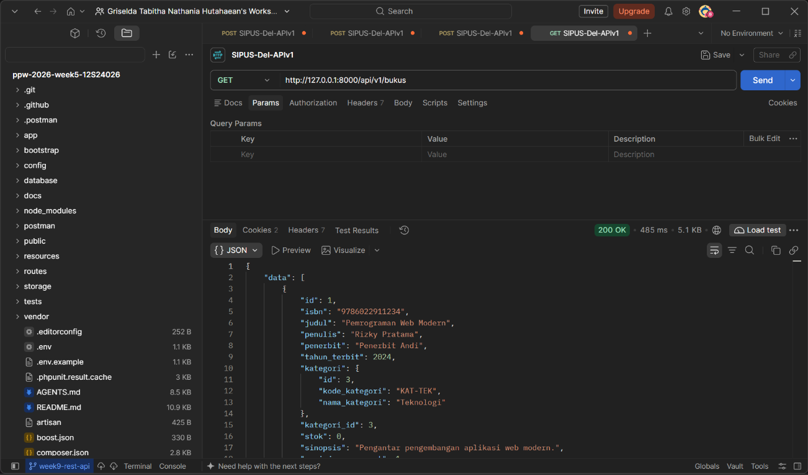
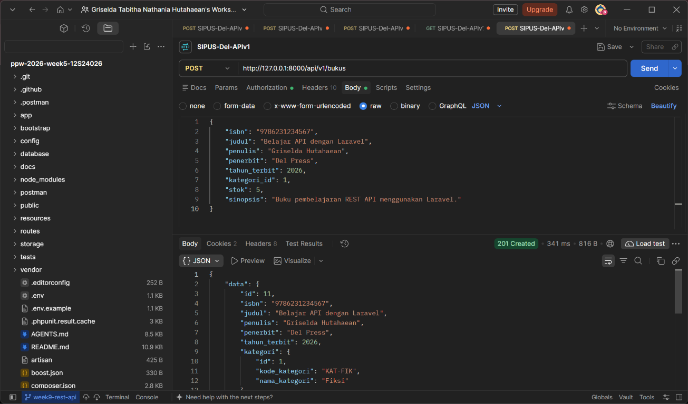
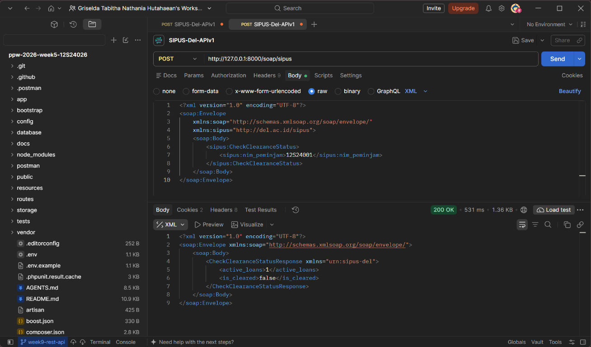
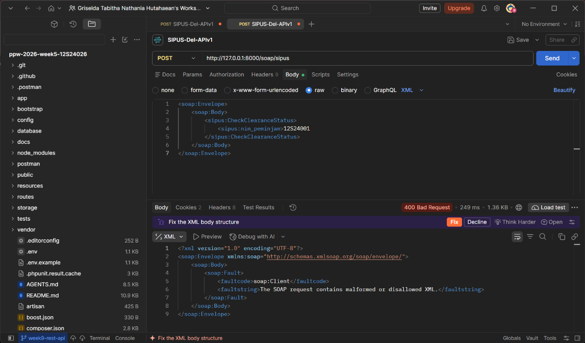

# SIPUS-Del

SIPUS-Del (Sistem Informasi Perpustakaan) adalah aplikasi perpustakaan berbasis web yang dikembangkan dengan Laravel. Aplikasi ini membantu pengelolaan data buku dan kategori buku secara terstruktur.

## Fitur Aplikasi

- Manajemen buku: menambah, melihat, mengubah, dan menghapus data buku.
- Manajemen kategori: menambah, melihat, mengubah, dan menghapus data kategori.
- Relasi antara buku dan kategori menggunakan Eloquent.
- Validasi input pada form buku dan kategori.
- Pagination pada daftar buku dan kategori.
- Notifikasi berhasil atau gagal setelah operasi tertentu.
- Tampilan responsif menggunakan Blade dan Tailwind CSS.
- Seeder untuk menyiapkan akun pustakawan, kategori, buku, dan transaksi contoh.
- Pencarian dan filter katalog, transaksi peminjaman, pengembalian, serta statistik sirkulasi.

## Teknologi yang Digunakan

- Laravel Framework 13.35.0
- PHP 8.3 atau lebih baru sesuai `composer.json` (lingkungan pengembangan terverifikasi menggunakan PHP 8.4.12)
- SQLite sebagai database default pada konfigurasi proyek
- Vite 7
- Tailwind CSS 4
- Laravel Vite Plugin 2
- Axios 1
- Composer dan npm

Versi package PHP utama yang terpasang di lingkungan pengembangan meliputi Laravel Boost 2.10.3, Laravel Pint 1.32.1, Faker 1.24.1, dan PHPUnit 12.5.38.

## Persyaratan Sistem

- PHP 8.3 atau lebih baru
- Composer 2.x
- Node.js dan npm
- SQLite untuk konfigurasi default
- Git

Versi yang digunakan saat pengembangan:

```text
PHP      8.4.12
Composer 2.10.3
Node.js  22.23.2
npm      10.9.8
```

Project tidak menetapkan versi minimum Node.js dan npm secara eksplisit. Versi di atas merupakan versi yang terverifikasi pada lingkungan pengembangan.

## Instalasi dan Konfigurasi

Perintah berikut dijalankan dari PowerShell.

### 1. Clone repository

```powershell
git clone https://github.com/GriseldaHutahaean/ppw-2026-week5-12S24026.git
cd ppw-2026-week5-12S24026
```

### 2. Pasang dependency PHP

```powershell
composer install
```

### 3. Siapkan file environment

```powershell
Copy-Item .env.example .env
```

Buka file `.env`, lalu sesuaikan `APP_NAME`, `APP_URL`, dan konfigurasi database jika diperlukan. Jangan membagikan file `.env` karena dapat berisi konfigurasi rahasia.

### 4. Buat application key

```powershell
php artisan key:generate
```

### 5. Siapkan dependency frontend

```powershell
npm install
npm run build
```

## Menyiapkan Database

Konfigurasi bawaan menggunakan SQLite. Jika file database belum ada, buat file kosong berikut:

```powershell
if (!(Test-Path database/database.sqlite)) {
    New-Item database/database.sqlite -ItemType File | Out-Null
}
```

Jalankan migration:

```powershell
php artisan migrate
```

Migration membuat tabel bawaan Laravel, tabel `kategoris`, dan tabel `bukus`. Tabel `bukus` memiliki relasi foreign key ke `kategoris` dan kategori tidak dapat dihapus jika masih digunakan oleh buku.

Seeder bersifat opsional dan digunakan untuk menyiapkan data contoh:

```powershell
php artisan db:seed
```

Seeder menyiapkan minimal lima kategori dan melengkapi data buku hingga minimal 20 data. Jangan menggunakan `migrate:fresh`, `db:wipe`, atau perintah reset lain pada database yang berisi data penting.

## Menjalankan Aplikasi

Jalankan server development dengan perintah berikut:

```powershell
php artisan serve
```

Buka alamat berikut pada browser:

```text
http://127.0.0.1:8000
```

Terminal tempat `php artisan serve` dijalankan harus tetap terbuka selama aplikasi digunakan. Halaman utama saat ini menampilkan view welcome bawaan Laravel, sedangkan fitur utama dapat diakses melalui:

- `http://127.0.0.1:8000/bukus`
- `http://127.0.0.1:8000/kategoris`

## Struktur Direktori

```text
app/
├── Http/Controllers/       Controller buku dan kategori
├── Http/Requests/           Form Request untuk validasi
└── Models/                  Model Buku, Kategori, dan User

database/
├── factories/               Factory untuk data contoh
├── migrations/              Struktur tabel database
└── seeders/                 Seeder data awal

resources/views/
├── bukus/                   View CRUD buku
├── kategoris/               View CRUD kategori
└── components/              Komponen layout Blade

routes/
└── web.php                  Route halaman web dan resource CRUD
```

## Validasi dan Relasi Data

### Validasi kategori

- `kode_kategori` wajib diisi, berupa string, maksimal 255 karakter, dan harus unik.
- `nama_kategori` wajib diisi dan berupa string.
- Saat update, validasi unik mengabaikan kategori yang sedang diedit.

### Validasi buku

- `isbn` wajib diisi, berupa string, maksimal 20 karakter, dan harus unik.
- `judul` wajib diisi dan minimal 5 karakter.
- `penulis` dan `penerbit` wajib diisi.
- `tahun_terbit` harus berupa bilangan bulat dari tahun 1000 sampai tahun berjalan.
- `kategori_id` wajib mengacu pada kategori yang tersedia.
- `stok` harus berupa bilangan bulat minimal 0.
- `sinopsis` boleh kosong.
- Saat update, validasi ISBN unik mengabaikan buku yang sedang diedit.

### Relasi Eloquent

- `Kategori::bukus()` menggunakan relasi `hasMany`.
- `Buku::kategori()` menggunakan relasi `belongsTo`.
- Daftar buku menggunakan eager loading `Buku::with('kategori')` agar nama kategori dapat ditampilkan tanpa query relasi berulang.

## Minggu 6

Minggu 6 menambahkan autentikasi pustakawan, session database, cookie email terakhir, pencarian katalog, statistik, serta transaksi peminjaman dan pengembalian yang aman dengan transaksi database dan `lockForUpdate`.

### Akun uji pustakawan

- Email: `pustakawan@del.ac.id`
- Password: `password123`

### Menjalankan Minggu 6

```powershell
composer install
Copy-Item .env.example .env
php artisan key:generate
```

Buat database MySQL bernama `ppw_week06`, lalu sesuaikan koneksi database di `.env` tanpa membagikan file tersebut. Setelah itu jalankan:

```powershell
php artisan migrate:fresh --seed
npm install
npm run build
php artisan serve
```

### Relasi data



### Bukti pengujian

Simpan screenshot hasil pengujian di folder [`docs/`](docs/). Bukti yang perlu dilengkapi:

1. Peminjaman berhasil dan stok berkurang.
2. Pengembalian berhasil dan stok bertambah.
3. Peminjaman buku dengan stok 0 ditolak dan stok tetap (rollback).
4. Pemeriksaan cookie `laravel_session` beratribut `HttpOnly` melalui DevTools.

## Minggu 9 — Web Services & REST API

Implementasi Minggu 9 menyediakan katalog REST API v1, autentikasi Bearer Token dengan Sanctum, transaksi peminjaman/pengembalian, konsumen OpenLibrary, serta endpoint SOAP terbatas untuk pemeriksaan status bebas pustaka. Spesifikasi kontraknya tersedia di [`docs/openapi-sipus-v1.yaml`](docs/openapi-sipus-v1.yaml).

### Persiapan dan uji lokal

Branch pengerjaan: `week9-rest-api`. Proyek ini menggunakan Laravel 13 dan PHP 8.3+; meskipun modul praktikum menyebut Laravel 11, implementasi mengikuti versi framework dan API yang benar-benar terpasang di repositori.

```powershell
composer install
Copy-Item .env.example .env
php artisan key:generate
php artisan migrate --seed
php artisan test
php artisan serve
```

### REST API

Endpoint katalog `GET /api/v1/bukus` dan detail `GET /api/v1/bukus/{id}` dapat diakses publik. Filter katalog meliputi `search`, `kategori_id`, `tersedia=1` atau `tersedia=0`, dan `sort` (misalnya `sort=-judul`). Respons buku menyertakan `_links`; tautan `pinjam_buku` hanya ada bila stok tersedia.

Endpoint mutasi dan sirkulasi memerlukan header `Authorization: Bearer <token>`. Kredensial uji dari seeder:

```text
POST /api/v1/auth/login
Content-Type: application/json

{"email":"pustakawan@del.ac.id","password":"password123"}
```

Jika kredensial benar, endpoint mengembalikan status `200 OK` dengan token Bearer dan data pengguna yang berhasil diautentikasi:

```json
{
  "data": {
    "token_type": "Bearer",
    "access_token": "<token-hasil-login>",
    "user": {
      "id": 1,
      "name": "Pustakawan Del",
      "email": "pustakawan@del.ac.id"
    }
  },
  "message": "Autentikasi berhasil."
}
```

Nilai `access_token` pada contoh di atas sengaja disamarkan. Gunakan `data.access_token` dari respons aktual untuk memanggil `/api/v1/auth/me`, mutasi buku, daftar peminjaman, peminjaman baru, dan pengembalian. Contoh:

```powershell
curl.exe -H "Authorization: Bearer <token>" http://127.0.0.1:8000/api/v1/peminjamans
```

Bukti pengujian login menggunakan Postman:



Bukti katalog publik berhasil diakses melalui `GET /api/v1/bukus`:



Bukti penambahan buku berhasil melalui `POST /api/v1/bukus` dengan respons `201 Created`:



Kesalahan API menggunakan `application/problem+json` (RFC 7807), termasuk validasi `422`, konflik `409`, autentikasi `401`, dan resource tidak ditemukan `404`. Pengembalian dan peminjaman mengunci baris buku di dalam transaksi database; untuk pengujian concurrency riil gunakan database yang mendukung row-level locking (misalnya MySQL/PostgreSQL), sebab SQLite tidak menerapkan `SELECT ... FOR UPDATE` dengan cara yang sama.

### SOAP legacy dan kelayakan layanan

- `GET /soap/sipus.wsdl` menyediakan WSDL 1.1 minimal untuk operasi `CheckClearanceStatus`.
- `POST /soap/sipus` menerima SOAP 1.1 XML berisi `nim_peminjam` dan menghitung transaksi berstatus `dipinjam`.
- XML dibatasi ukurannya, diproses tanpa akses jaringan entitas eksternal, dan input tidak valid menghasilkan `soap:Fault`. Pengecualian CSRF hanya berlaku untuk path `soap/*`; route tetap hanya-baca.
- SOAP masih layak sebagai adapter interoperabilitas bagi klien lama yang membutuhkan XML/WSDL, tetapi tidak disarankan sebagai API baru karena kontrak dan tooling lebih rumit. Untuk layanan baru, gunakan REST v1 dengan JSON, HATEOAS, bearer token, serta RFC 7807.
- Implementasi SOAP latihan ini belum menyediakan WS-Security atau otorisasi identitas mahasiswa. Jangan mengekspos pemeriksaan NIM ke jaringan publik tanpa HTTPS, autentikasi, pembatasan laju, dan kebijakan privasi yang sesuai.

Bukti pengujian SOAP berhasil dengan respons `200 OK`:



Bukti SOAP Fault saat XML request tidak valid dengan respons `400 Bad Request`:



### Pengujian cepat

1. Jalankan `php artisan test` untuk tes katalog/filter, Bearer Token, kontrak RFC 7807, validasi PUT/PATCH, pencegahan peminjaman ganda, update stok, SOAP Fault, dan fallback OpenLibrary.
2. Login melalui `POST /api/v1/auth/login`; pastikan token yang diterima dapat dipakai pada `GET /api/v1/auth/me`, lalu tidak berlaku lagi setelah `POST /api/v1/auth/logout`.
3. Pinjam buku lewat `POST /api/v1/peminjamans` dengan `buku_id`, `nim_peminjam`, dan `nama_peminjam`; verifikasi stok berkurang satu. Alternatif HATEOAS `POST /api/v1/bukus/{id}/peminjamans` menerima payload yang sama tanpa `buku_id`.
4. Kembalikan lewat `PATCH /api/v1/peminjamans/{id}/kembalikan`; verifikasi status `dikembalikan`, tanggal pengembalian, stok bertambah satu, dan tautan `kembalikan_buku` hilang.
5. Untuk SOAP, kirim `Content-Type: text/xml` ke `/soap/sipus` dengan envelope SOAP dan elemen `nim_peminjam`; periksa `active_loans` serta `is_cleared`.
6. Referensi eksternal membaca OpenLibrary dengan timeout 8 detik; ISBN tak dikenal atau gangguan koneksi menghasilkan fallback JSON yang eksplisit.

## Pengembang

**Griselda Hutahaean**

Repository: [ppw-2026-week5-12S24026](https://github.com/GriseldaHutahaean/ppw-2026-week5-12S24026)
